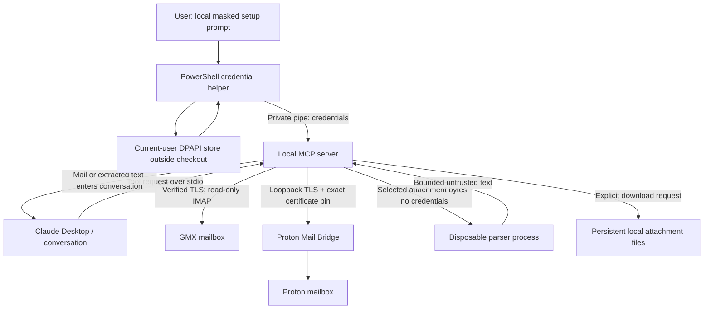

# Architecture

[Home](../README.md) · [Setup](setup.md) · [Reference](reference.md) · [Security](../SECURITY.md)

The extension is a local TypeScript MCP server using stdio. Claude Desktop starts
it with non-secret configuration. Each mail operation opens a bounded IMAP
session; there is no background synchronization or persistent mailbox cache.

## Data flow

## Credentials and transport

- The PowerShell helper stores the complete username/password payload under
  current-user Windows DPAPI with restricted ACLs. The store lives outside the
  repository. Only the main server receives decrypted credentials.
- GMX uses verified TLS on port 993 with Node's default roots plus Windows-trusted
  roots. Hostname checks remain enabled. Already trusted antivirus or enterprise
  intermediaries may inspect this connection.
- Proton uses loopback TLS or mandatory STARTTLS, the locally imported public
  certificate, and an exact fingerprint pin before authentication. It does not
  inherit GMX's Windows trust configuration.
- The server exposes no SMTP or mailbox mutation tools. Read-only mailbox opens
  and PEEK fetches preserve message flags.

## Messages and references

Search fetches summaries first. Message references carry account, folder,
UIDVALIDITY, and UID so a mailbox reset cannot silently redirect an old reference
to another message. Signed cursors bind the search filters and pagination window;
they expire after 15 minutes or server restart.

Reading a message fetches its structure and selected body part. Attachment content
is fetched separately, only when requested. HTML is converted to text without
fetching remote images.

## Attachment boundary

Selected attachment bytes go to a disposable Node process with a minimal
environment, a 30-second deadline, and a 256 MiB JavaScript heap cap. Credentials
are not passed to it. The parser returns bounded text marked as untrusted.
It does not execute PDF scripts, Office macros, or spreadsheet formulas.

These are resource controls, not an OS sandbox: the worker runs as the same
Windows user, and native memory is not fully bounded by the JavaScript heap cap.

Downloads use generated, exclusively created filenames below
`LocalMailAttachments` in the configured directory. Path checks reject network
shares and reparse points. Files persist and are never opened automatically.

## Source map

Source links point to the repository so this guide also works in a bundle.

| Area | Owning source |
| --- | --- |
| MCP registration and annotations | [server.ts](https://github.com/GranatenUdo/local-mail-claude-extension/blob/main/src/server.ts) |
| Configuration and TLS policy | [config.ts](https://github.com/GranatenUdo/local-mail-claude-extension/blob/main/src/config.ts) |
| Credentials | [credentials.ts](https://github.com/GranatenUdo/local-mail-claude-extension/blob/main/src/credentials.ts) and [CredentialStore.ps1](https://github.com/GranatenUdo/local-mail-claude-extension/blob/main/scripts/CredentialStore.ps1) |
| IMAP sessions and messages | [connections.ts](https://github.com/GranatenUdo/local-mail-claude-extension/blob/main/src/connections.ts) and [mail.ts](https://github.com/GranatenUdo/local-mail-claude-extension/blob/main/src/mail.ts) |
| Schemas and limits | [models.ts](https://github.com/GranatenUdo/local-mail-claude-extension/blob/main/src/models.ts) and [security.ts](https://github.com/GranatenUdo/local-mail-claude-extension/blob/main/src/security.ts) |
| Attachment processing | [parser-process.ts](https://github.com/GranatenUdo/local-mail-claude-extension/blob/main/src/parser-process.ts), [extraction.ts](https://github.com/GranatenUdo/local-mail-claude-extension/blob/main/src/extraction.ts), and [downloads.ts](https://github.com/GranatenUdo/local-mail-claude-extension/blob/main/src/downloads.ts) |

See [security boundaries](../SECURITY.md) for same-user compromise, prompt
injection, local storage, and distribution limitations.
